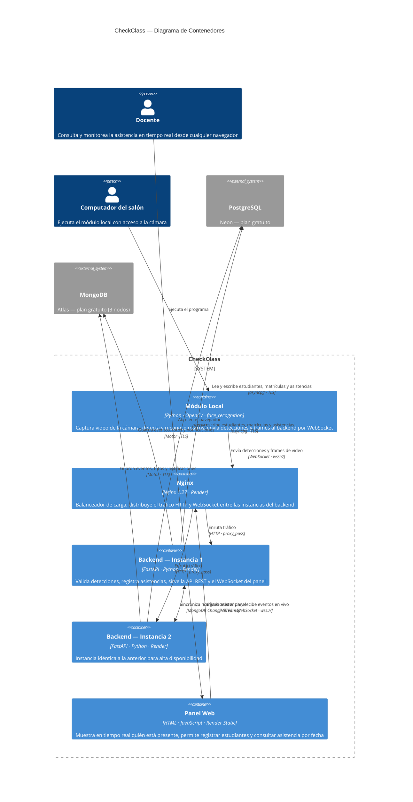

# Diagrama C4 — Nivel 2: Contenedores

## Descripción de los contenedores

| Contenedor | Tecnología | Responsabilidad |
|---|---|---|
| Módulo Local | Python, OpenCV, face_recognition | Detecta y reconoce rostros; envía eventos al backend |
| Nginx | Nginx 1.27 | Balancea carga entre las dos instancias del backend |
| Backend (×2) | FastAPI, asyncpg, Motor | API REST + WebSocket; persiste asistencias; sincroniza paneles |
| Panel Web | HTML, JavaScript | Interfaz en tiempo real para el docente |
| PostgreSQL | Neon | Datos relacionales estructurados |
| MongoDB | Atlas | Eventos crudos, fotos y coordinación entre instancias |
