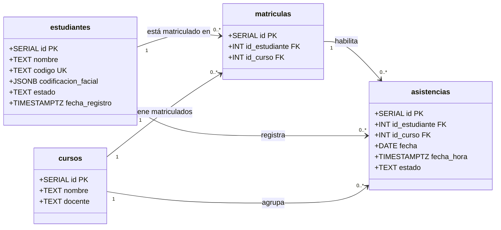
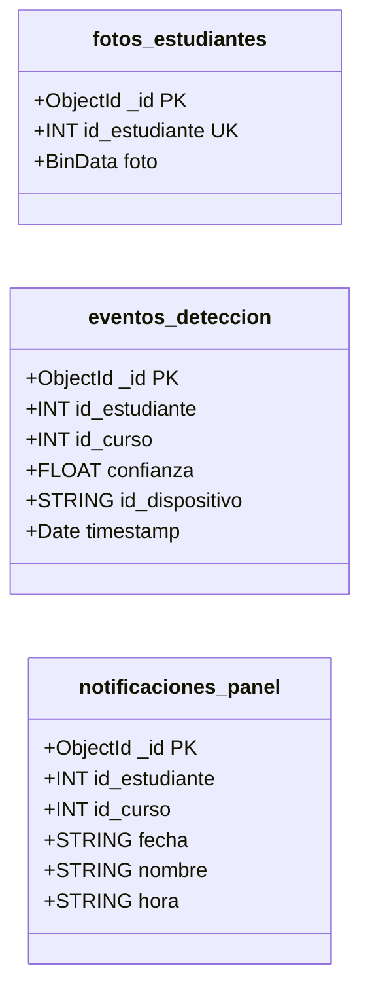

# Diagrama UML — Modelo de datos

## PostgreSQL (datos relacionales)

### Restricciones destacadas

| Tabla | Restricción |
|---|---|
| `estudiantes` | `codigo` único; `estado` ∈ `{AC, IN}` |
| `cursos` | `(nombre, docente)` único |
| `matriculas` | `(id_estudiante, id_curso)` único |
| `asistencias` | `(id_estudiante, id_curso, fecha)` único |

---

## MongoDB (datos de documentos)

> Las colecciones de MongoDB no tienen claves foráneas formales. `id_estudiante` e `id_curso` corresponden a los IDs de PostgreSQL por convención.
